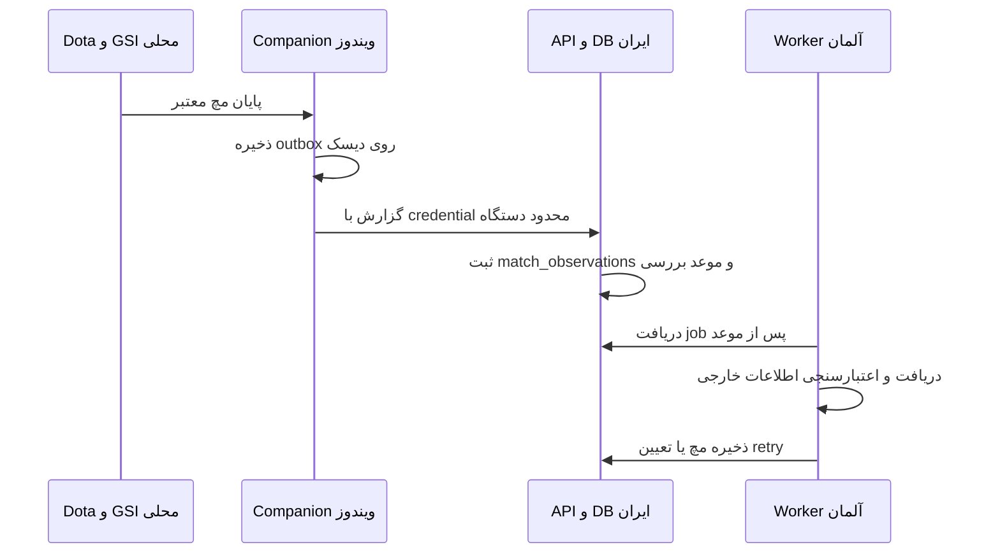

# دریافت خودکار مچ و Fetch دستی

## روش اصلی

Companion یک executable مستقل Windows است که Task Scheduler آن را با ورود کاربر به نشست ویندوز اجرا می کند.
بستن پنجره Dota Notes آن را متوقف نمی کند. خاموش بودن سیستم، خروج از نشست ویندوز یا logout حساب برنامه، شرایط متفاوت اند.
این اجرا به Windows Service، رمز Steam کاربر یا اتصال GC کلاینت نیاز ندارد.



## راه اندازی بازی

یک بار وارد حساب Dota Notes شو تا دستگاه ثبت و task ساخته شود. در Steam:
`Library > Dota 2 > Properties > General > Launch Options`
این گزینه را بدون پاک کردن گزینه های قبلی اضافه کن و بازی را دوباره اجرا کن:

```text
-gamestateintegration
```

دکمه اجرای Dota داخل برنامه گزینه را برای همان اجرا می فرستد؛ برای اجرای مستقیم Steam آن را در Launch Options نگه دار.
پیکربندی محلی در `game/dota/cfg/gamestate_integration/gamestate_integration_dota_notes.cfg` ساخته می شود.
listener فقط `127.0.0.1:16272/gsi` است؛ این پورت در firewall اینترنتی VPS باز نمی شود.

## اعتبار و زمان بندی

- GSI باید appid برابر 570، شناسه Steam خود کاربر، تیم Radiant/Dire و حالت `POST_GAME` داشته باشد.
- رویداد ابتدا روی دیسک ذخیره و ارسال تقریبا هر ۳۰ ثانیه تلاش می شود. اینترنت موقت قطع باشد، outbox باقی می ماند.
- اولین بررسی DB زودتر از پنج دقیقه بعد از پایان ثبت شده بازی نیست؛ تاخیر صف و provider ممکن است زمان بیشتری اضافه کند.
- فاصله retry پس از شکست به ترتیب ۳، ۵، ۱۰، ۲۰ و سپس ۳۰ دقیقه است؛ `Retry-After` بزرگ تر provider رعایت می شود.
- مهلت job یک روز پس از پذیرش سرور است. رویداد قدیمی تر از ۳۰ روز یا بیش از یک دقیقه در آینده پذیرفته نمی شود.
- credential دستگاه برای گزارش مچ و ابطال خودش محدود است؛ session کامل برنامه نیست و ۱۸۰ روز اعتبار دارد.
- باز کردن مجدد UI برای دستگاه معتبر، token را بی دلیل عوض نمی کند. نزدیک انقضا، با باز شدن برنامه دستگاه جایگزین می شود.
- ورود عادی UI با credential دستگاه متفاوت است. logout تلاش می کند دسترسی دستگاه را لغو و task محلی را حذف کند؛ بستن پنجره logout نیست.
- داده provider باید عضویت همان بازیکن را نشان بدهد؛ شناسه ادعاشده به تنهایی مجوز ثبت مچ دیگران نیست.

فعال بودن task فقط اجرای فرایند را نشان می دهد، نه دریافت صحیح GSI یا پیدا شدن مچ در provider.
در سورس فعلی برخی خطاهای نوشتن فایل GSI عمدا به UI پرتاب نمی شوند و فرایند دوره ای دوباره تلاش می کند؛ سلامت واقعی با دریافت رویداد سنجیده شود.

## مسیر جایگزین و Fetch دستی

بررسی دوره ای server-side با `SCHEDULED_SYNC_ENABLED=on` باید در آلمان فعال باشد؛ به باز بودن UI وابسته نیست. وضعیت واقعی env هر میزبان باید جدا تایید شود.
فاصله پیش فرض هر حساب یک ساعت و پنجره پیش فرض ۴۸ ساعت است؛ به معنی درخواست خارجی برای همه حساب ها هر پنج ثانیه نیست.
Fetch دستی روزانه، هفتگی و ماهانه برای بازی روی سیستم دیگر یا مچ جا افتاده باقی است.

هر job دستی یک snapshot تاریخچه نگه می دارد. دسته های بعدی همان فهرست را ادامه می دهند؛ جزئیات مچ واردشده یا حذف شده توسط کاربر دوباره وارد نمی شود.
کش معتبر جزئیات بین حساب ها هم قابل استفاده است، ولی عضویت بازیکن دوباره بررسی می شود.
کش تاریخچه تا یک روز نگه داشته می شود؛ بازبینی اخیر ۴۸ ساعته و بازخوانی کامل پس از پایان اعتبار مانع مهر و موم دائمی روزهای گذشته می شود.
هر دسته فعلی حداکثر ۲۰ مچ جدید و حدود ۲۰ ثانیه بودجه حلقه دارد؛ درخواست provider جاری می تواند پایان دسته را عقب بیندازد.
`externalRequests` تلاش های خارجی شمرده شده در job را نشان می دهد؛ صفر بودن تکرار جزئیات با صفر بودن همه درخواست های کشف تاریخچه یکی نیست.

روز نمایشی بر مبنای شروع رسمی مچ در `Asia/Tehran` است؛ پایان بازی نزدیک نیمه شب نباید مرز زمان Fetch را به حذف دائمی مچ تبدیل کند.

## محل های مهم و بررسی

| مورد | محل |
| --- | --- |
| config، outbox و sent | `%LOCALAPPDATA%\DotaNotesShared\companion` |
| credential | Windows Credential Manager؛ متن token داخل config ذخیره نمی شود |
| task | `DotaNotes-Companion-*` برای کاربر جاری |
| وضعیت سرور | `companion_devices` و `match_observations` در DB ایران |
| پردازش | `dota2notes-sync-daemon.service` آلمان |

`device.json` شامل secret محلی GSI است؛ آن را عمومی ارسال نکن.
دستورهای بررسی در [عیب یابی](troubleshooting.fa.md) و سناریوی واقعی در [پذیرش](acceptance-tests.fa.md) آمده اند.
