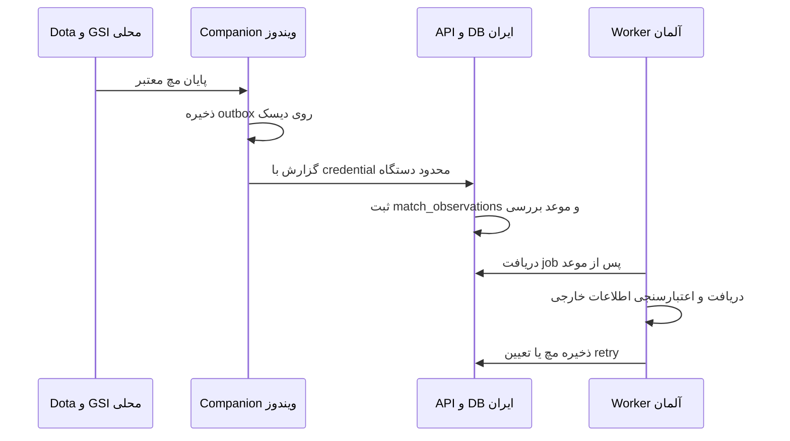

# دریافت خودکار مچ و Fetch دستی

## روش اصلی

Companion یک executable مستقل Windows است که Task Scheduler آن را با ورود کاربر به نشست ویندوز اجرا می کند.
بستن پنجره Dota Notes آن را متوقف نمی کند. خاموش بودن سیستم، خروج از نشست ویندوز یا logout حساب برنامه، شرایط متفاوت اند.
این اجرا به Windows Service، رمز Steam کاربر یا اتصال GC کلاینت نیاز ندارد.



## راه اندازی بازی

یک بار وارد Dota Notes شو تا دستگاه ثبت و task ساخته شود. Companion برای هر Steam ID که در پایگاه داده ثبت شده باشد رویداد مچ را به همان حساب نسبت می دهد؛ تعداد حساب ها ثابت نیست. برای شناسه ثبت نشده فقط عضویت بررسی می شود، رویداد مچ به API ارسال نمی شود و فایل محلی موقت کنار گذاشته می شود. ثبت نام بعدی آن حساب، دریافت اولیهٔ سه روز اخیر را از سرور آغاز می کند.

راه اندازی در پس زمینه انجام می شود و کارت جداگانه ای در صفحهٔ اصلی ندارد. در صفحهٔ **Launch Options** وضعیت ثبت Task Scheduler، فعال بودن listener محلی GSI، وجود دو گزینهٔ ضروری در فایل Steam و زمان آخرین پیام GSI جداگانه نشان داده می شود. اگر راه اندازی کامل نشده باشد، دکمهٔ «تلاش دوباره برای راه اندازی» همان صفحه مرحلهٔ ناموفق را با کد خطا مشخص می کند. ثبت task و باز بودن listener به تنهایی دریافت رویداد واقعی بازی را تأیید نمی کند.

Companion در پس زمینه Launch Options حساب های محلی ثبت شده را بررسی می کند و دو گزینهٔ ضروری زیر را با حفظ سایر گزینه ها نگه می دارد. فهرست گزینه های اختیاری از `apps/desktop/shared/launch-options.json` خوانده می شود؛ برای افزودن گزینهٔ تازه، نام و ناسازگاری های آن باید در همان فهرست ثبت شوند:

```text
-gamestateintegration
-console
```

برای نوشتن این تنظیم، Steam باید کاملاً بسته باشد. Companion بازی باز را قطع نمی کند و بعد از بسته شدن Steam دوباره تلاش می کند. صفحهٔ Launch Options برنامه گزینه های دلخواه `-novid`، `-fullscreen` و `-windowed` را هم دارد؛ دو حالت نمایش هم زمان قابل انتخاب نیستند. تنظیم دلخواه هنگام باز بودن Steam ذخیره می شود و بعداً اعمال می گردد. فایل قبلی پیش از هر تغییر کنار خودش backup می شود. اگر فایل یا مسیر Steam قابل تشخیص نباشد، روش دستی در کارت برنامه در دسترس است: `Steam > Library > Dota 2 > Properties > General > Launch Options`. این مسیر فایل، رابط رسمی نوشتن Steam نیست و رفتار آن روی نصب واقعی Windows باید جدا بررسی شود.

دکمهٔ اجرای Dota داخل برنامه گزینه را برای همان اجرا می فرستد؛ تنظیم دائمی بالا برای اجرای مستقیم از Steam است. تشخیص وجود گزینه، دریافت واقعی GSI را ثابت نمی کند. Fetch دستی به این تنظیم وابسته نیست.
پیکربندی محلی در `game/dota/cfg/gamestate_integration/gamestate_integration_dota_notes.cfg` ساخته می شود.
listener فقط `127.0.0.1:16272/gsi` است؛ این پورت در firewall اینترنتی VPS باز نمی شود.

## اعتبار و زمان بندی

- GSI باید appid برابر 570، شناسه Steam معتبر، تیم Radiant/Dire و حالت `POST_GAME` داشته باشد. شناسه با حساب ثبت شده در سرور تطبیق داده می شود و عضویت بازیکن در دادهٔ provider نیز جدا بررسی می شود.
- رویداد ابتدا روی دیسک ذخیره و ارسال تقریبا هر ۳۰ ثانیه تلاش می شود. اینترنت موقت قطع باشد، outbox باقی می ماند.
- اولین بررسی DB زودتر از پنج دقیقه بعد از پایان ثبت شده بازی نیست؛ تاخیر صف و provider ممکن است زمان بیشتری اضافه کند.
- فاصله retry پس از شکست به ترتیب ۳، ۵، ۱۰، ۲۰ و سپس ۳۰ دقیقه است؛ `Retry-After` بزرگ تر provider رعایت می شود.
- مهلت job یک روز پس از پذیرش سرور است. رویداد قدیمی تر از ۳۰ روز یا بیش از یک دقیقه در آینده پذیرفته نمی شود.
- credential دستگاه برای گزارش مچ و ابطال خودش محدود است؛ session کامل برنامه نیست و ۱۸۰ روز اعتبار دارد. حداکثر ۱۶ دستگاه فعال برای هر حساب و در هر ۲۴ ساعت حداکثر ۵۰۰۰ بررسی عضویت و ۱۰۰ گزارش برای مجموع دستگاه های آن حساب پذیرفته می شود.
- باز کردن مجدد UI برای دستگاه معتبر، token را بی دلیل عوض نمی کند. نزدیک انقضا، با باز شدن برنامه دستگاه جایگزین می شود.
- ورود عادی UI با credential دستگاه متفاوت است. logout فقط نشست UI را پایان می دهد؛ Companion برای حساب های ثبت شدهٔ این دستگاه فعال می ماند. خاموش کردن «دریافت خودکار در پس زمینه» در صفحهٔ Launch Options، task و GSI را متوقف و credential دستگاه را لغو می کند؛ روشن کردن دوباره به ورود به برنامه نیاز دارد.
- داده provider باید عضویت همان بازیکن را نشان بدهد؛ شناسه ادعاشده به تنهایی مجوز ثبت مچ دیگران نیست.

فعال بودن task فقط اجرای فرایند را نشان می دهد، نه دریافت صحیح GSI یا پیدا شدن مچ در provider.
در سورس فعلی برخی خطاهای نوشتن فایل GSI عمدا به UI پرتاب نمی شوند و فرایند دوره ای دوباره تلاش می کند؛ سلامت واقعی با دریافت رویداد سنجیده شود.

## مسیر جایگزین و Fetch دستی

بررسی دوره ای server-side با `SCHEDULED_SYNC_ENABLED=on` باید در آلمان فعال باشد؛ به باز بودن UI وابسته نیست. وضعیت واقعی env هر میزبان باید جدا تایید شود.
فاصله پیش فرض هر حساب یک ساعت و پنجره پیش فرض ۴۸ ساعت است؛ به معنی درخواست خارجی برای همه حساب ها هر پنج ثانیه نیست. ثبت Steam ID تازه یک job پایدار مستقل برای ۷۲ ساعت گذشته می سازد، پیش از پایان مراحل ثبت نام. صف های دریافت اولیه و دوره ای همهٔ مچ های بازه را در دسته های محدود ادامه می دهند؛ ۲۰ سقف نهایی دریافت نیست. جزئیات مچ تازه ای که provider هنوز آماده نکرده، در job ثبت نام هر ۱۵ دقیقه تا حداکثر ۲۴ ساعت دوباره بررسی می شود؛ پس از مهلت، job با خطای قابل بررسی بسته می شود.
Fetch دستی روزانه، هفتگی و ماهانه برای بازی روی سیستم دیگر یا مچ جا افتاده باقی است.

هر job دستی یک snapshot تاریخچه نگه می دارد. دسته های بعدی همان فهرست را ادامه می دهند؛ جزئیات مچ واردشده یا حذف شده توسط کاربر دوباره وارد نمی شود.
کش معتبر جزئیات بین حساب ها هم قابل استفاده است، ولی عضویت بازیکن دوباره بررسی می شود.
کش تاریخچه تا یک روز نگه داشته می شود؛ بازبینی اخیر ۴۸ ساعته و بازخوانی کامل پس از پایان اعتبار مانع مهر و موم دائمی روزهای گذشته می شود.
هر دسته فعلی حداکثر ۲۰ مچ جدید و حدود ۲۰ ثانیه بودجه حلقه دارد؛ درخواست provider جاری می تواند پایان دسته را عقب بیندازد.
`externalRequests` تلاش های خارجی شمرده شده در job را نشان می دهد؛ صفر بودن تکرار جزئیات با صفر بودن همه درخواست های کشف تاریخچه یکی نیست.

روز نمایشی بر مبنای شروع رسمی مچ در `Asia/Tehran` است؛ پایان بازی نزدیک نیمه شب نباید مرز زمان Fetch را به حذف دائمی مچ تبدیل کند.

## محل های مهم و بررسی

| مورد | محل |
| --- | --- |
| config، outbox و sent | `%LOCALAPPDATA%\DotaNotesShared\companion` |
| credential | Windows Credential Manager؛ متن token داخل config ذخیره نمی شود |
| task | `DotaNotes-Companion-*` برای کاربر جاری |
| وضعیت سرور | `companion_devices` و `match_observations` در DB ایران |
| پردازش | `dota2notes-sync-daemon.service` آلمان |

`device.json` شامل secret محلی GSI است؛ آن را عمومی ارسال نکن.
دستورهای بررسی در [عیب یابی](troubleshooting.fa.md) و سناریوی واقعی در [پذیرش](acceptance-tests.fa.md) آمده اند.
