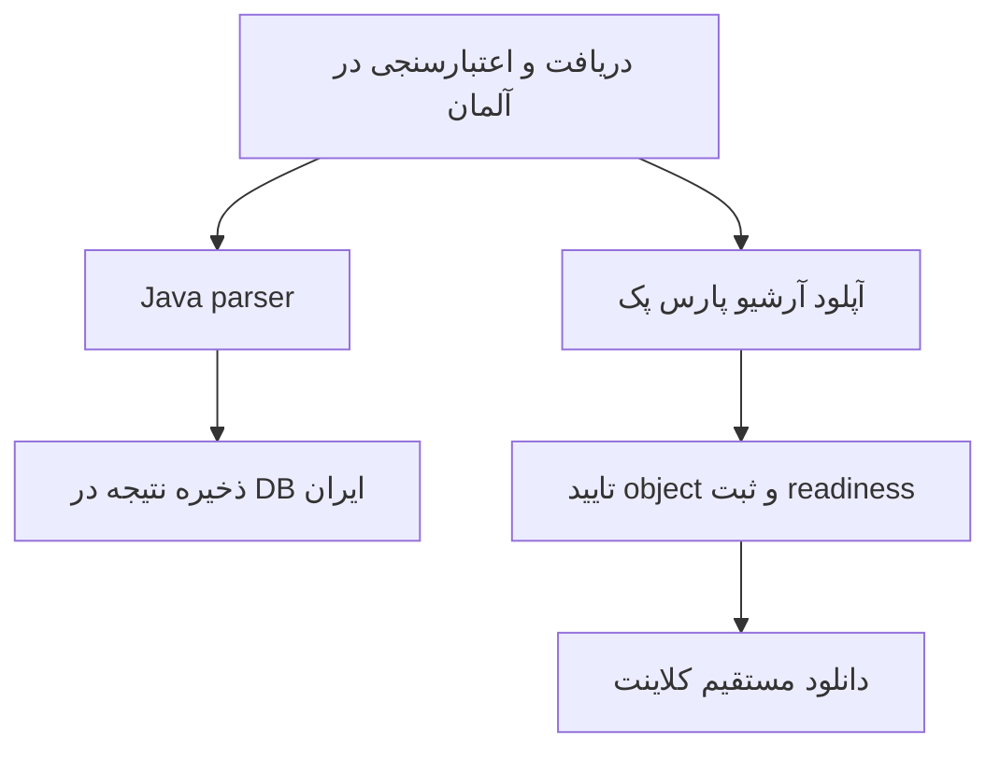

# دانلود ریپلی و استقلال از تحلیل

## مسیر فعلی

کاربر به API ایران درخواست می دهد. آلمان فایل را از آرشیو موجود یا Valve تهیه و اعتبارسنجی می کند.
فایل کامل spool برای دو مسیر مستقل parse و upload قابل استفاده است. parser و آرشیو لازم نیست پشت سر هم تمام شوند.
نتیجه تحلیل در DB ایران و آرشیو در پارس پک ثبت می شوند؛ readiness دانلود به سلامت آرشیو وابسته است، نه completed شدن تحلیل.

## ثبت درخواست و اولویت

`POST /api/replays/:matchId` با `intent: download` تقاضای دانلود را ثبت می کند.
`download_requested_at` اولویت کوتاه مدت آماده سازی و archive را بالا می برد. fairness صف حفظ می شود؛ upload یا prepare فعال قطع نمی شود.
آماده بودن یک replay نباید به پایان همه تحلیل های دیگر وابسته باشد.
صف دانلود native روی هر کلاینت تک انتقالی است؛ درخواست دوم ممکن است منتظر انتقال فعال همان دستگاه بماند، حتی اگر archive سرور آماده باشد.

کلاینت وضعیت دانلود را با timer جدا از `/api/tasks` می خواند. خراب بودن دریافت فهرست تحلیل ها به تنهایی نباید مانع بررسی readiness شود.
برای تشخیص تاخیر، چهار زمان جدا ثبت شوند: درخواست، آماده شدن archive، آغاز انتقال native و پایان انتقال.

## ticket و امنیت فایل

`GET /api/replays/:matchId/download` بعد از احراز هویت، کلید همان مچ، اندازه آرشیو و SHA256 را کنترل می کند.
پاسخ `download` شامل `url`، `bytes`، `sha256` و `expiresAt` است. URL یک presigned GET با اعتبار پانزده دقیقه است.
پاسخ خصوصی و `no-store` است؛ URL یا secret در گزارش عمومی قرار نگیرد.
Secret Key به کلاینت نمی رسد؛ شناسه Access Key می تواند جزو URL امضاشده S3 باشد.

نبود آرشیو آماده `409 replay_archive_pending` و اختلال storage خطای 503 دارد.
native ابتدا ticket را با bearer برنامه از ایران می گیرد، سپس بدون bearer یا Cookie برنامه فایل را از storage می گیرد.
در نسخه فعلی فقط HTTPS و میزبان `c677095.parspack.net` مجازند؛ redirect، userinfo، پورت نامعتبر و نام مچ دیگر رد می شوند.
تغییر storage علاوه بر env، به بررسی allowlist native و احتمالا نصاب تازه نیاز دارد.

SHA256 روی بایت های شبکه و قبل از نهایی شدن فایل کنترل می شود؛ raw، BZip2 و Zstandard با محتوا تشخیص داده می شوند.
سقف ورودی ۲۰۰ MiB و خروجی بازشده ۲ GiB است. timeout اتصال بیست ثانیه و کل انتقال پانزده دقیقه است؛ resume بایتی نداریم.
فایل ناقص با نام نهایی معتبر جایگزین نمی شود. endpoint قدیمی `/file` برای سازگاری نسخه های قدیمی باقی است، مسیر اصلی نصاب جدید نیست.

## خطا، تلاش مجدد و ظاهر

- `directDownloadReady` آماده بودن storage را مشخص می کند؛ وجود spool آلمان کافی نیست.
- تحلیل می تواند completed باشد ولی archive هنوز pending یا failed باشد. این دو وضعیت را یکی نکن.
- انتظار آماده سازی در کلاینت سقف سی دقیقه دارد. خطای نهایی از شمارنده فعال خارج و قابل بستن است؛ خطای مچ برای عیب یابی باقی می ماند.
- پایان بودجه archive دانلود را ناموفق می کند. تقاضای صریح تازه می تواند بودجه آرشیو را دوباره آغاز کند؛ retry بی پایان نداریم.
- تسک کامل شده از پنل فعالیت حذف می شود؛ پیام کوتاه تکمیل و نشان «دانلود شده» جای آن را می گیرند.
- نشانگر تحلیل پنج نقطه دارد: صف، آماده سازی، دریافت و اعتبارسنجی، تحلیل و آماده. وضعیت جدید سرور بلافاصله نمایش داده می شود؛ انیمیشن کوتاه تیک و اتصال، مرحله های ردشده را به صورت کار در حال اجرا بازپخش نمی کند.
- درصد دریافت و سرعت فقط از بایت ها و اندازه گزارش شده سرور محاسبه می شوند؛ این انتقال روی آلمان انجام می شود، نه روی دستگاه کاربر. اندازه نامعلوم و مرحله های بدون درصد واقعی فقط فعالیت را نشان می دهند.
- موج فقط در مرحله فعال دیده می شود؛ در صفر درصد، مرحله تکمیل شده، صف انتظار، تلاش مجدد و خطا موج نداریم. تنظیم کاهش حرکت برنامه و سیستم و پنهان بودن پنجره رعایت می شوند.
- نقطه پنجم آماده بودن تحلیل را نشان می دهد و نشانه آماده بودن آرشیو نیست. وضعیت دقیق دانلود از مسیر مستقل دانلود خوانده می شود؛ نشانگر تحلیل از روی تکمیل تحلیل، سلامت آرشیو را حدس نمی زند.
- تقدم وضعیت با هویت درخواست و زمان جدیدتر تعیین می شود تا خطای cache قدیمی درخواست تازه را بازنویسی نکند.

تست زنده دو گروه پنج مچی در [پذیرش](acceptance-tests.fa.md) آمده است.
