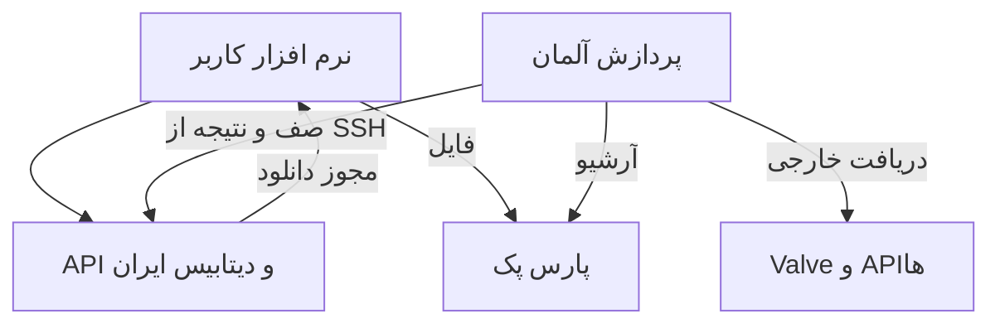

# معماری دو VPS

ایران API عمومی و یک PostgreSQL معتبر دارد؛ آلمان همه workerهای پردازش و دریافت
خارجی را اجرا می کند. همان queueهای موجود با transaction، lease، heartbeat و
قفل advisory حفظ می شوند. worker از همان DB کار می گیرد و نتیجه را همان جا ثبت
می کند؛ به صف تازه یا هماهنگی دو دیتابیس نیاز نداریم.

## کانال خصوصی

آلمان SSH را به حساب محدود `dota-link` ایران آغاز می کند:

- `-L 127.0.0.1:15432:127.0.0.1:5432`: اتصال PostgreSQL worker به ایران.
- `-R 127.0.0.1:14100:127.0.0.1:4100`: هدایت عملیات منتخب ایران به API خصوصی آلمان.
- همه listenerها loopback هستند. PG روی اینترنت باز نمی شود. host key باید تایید شود.
- API خصوصی، علاوه بر session کاربر، secret پل را بررسی می کند. endpoint worker
  secret مستقل قبلی را نگه می دارد. مسیر یا مقصد URL دلخواه از کاربر گرفته نمی شود.

مبنای فنی: [ssh](https://man.openbsd.org/ssh)،
[ssh_config](https://man.openbsd.org/ssh_config) و
[sshd_config](https://man.openbsd.org/sshd_config).
این کانال اختلال شبکه را حذف نمی کند؛ ارتباط رمزگذاری شده و reconnect فراهم می کند.

## چه چیزهایی در ایران می مانند

خواندن session، مچ، ژورنال، وضعیت تسک و ثبت درخواست دریافت/آنالیز محلی است.
Steam، ایمیل، lookup خارجی و عملیات مدیریتی وابسته به فایل آلمان از allowlist
محدود به compute هدایت می شوند. عملیات نوشتنی HTTP خودکار تکرار نمی شود؛ بعد از
Timeout ممکن است کار انجام شده باشد و وضعیت باید پیش از درخواست دوباره خوانده شود.

در قطع لینک، داده ذخیره شده و enqueue ایران در دسترس اند، ولی workerها و عملیات
نیازمند upstream عقب می افتند. بازیابی lease قبلی بعد از برگشت اتصال ادامه کار را
ممکن می کند. شبکه قطع شده ممکن است از بودجه تلاش موجود مصرف کند؛ تلاش بی نهایت نداریم.

## زمان و منابع

parser، فایل موقت و دریافت Valve روی آلمان می مانند تا فایل ۱۵۰ MiB برای هر
آنالیز به ایران منتقل نشود. خروجی پردازش و SQL هنوز از کانال می گذرند؛ زمان این
مرحله جدا باید سنجیده شود. از سرعت تست S3 نمی توان زمان ثابت آنالیز نتیجه گرفت.

daemon دریافت مچ، `sync --watch`، پس از هر نوبت پنج ثانیه صبر می کند و نوبت ها را
همپوشان اجرا نمی کند. انتظار timer سی ثانیه ای حذف می شود؛ quota و الگوریتم history
تغییر نمی کنند. timer قدیمی sync/manual-sync همزمان فعال نباشد.

صفحه مانیتور پردازش و ریپلی به آلمان هدایت می شود تا آمار دیسک و سرویس همان میزبان
را بخواند. health ایران همچنان محلی است. unitهای عمدا خاموش در collector قدیمی
ممکن است inactive دیده شوند؛ این به خودی خود خطای سرویس نیست.

ورودی جهانی و failover چندمنطقه ای ساخته نشده است. کاربران خارج نیز فعلا به API
ایران وصل می شوند؛ دسترسی از همه ISPها تضمین نشده و دیتابیس اصلی دوم وجود ندارد.

## دریافت خودکار و رسانه های دسکتاپ

رویدادهای محدود GSI از پردازش مستقل ویندوز به API ایران وارد صف `match_observations` می شوند. worker آلمان پس از زمان مقرر اطلاعات را می گیرد. دریافت دستی از snapshot پایدار تاریخچه استفاده می کند. فایل های عمومی assets از ایران منتشر و در `DotaNotesShared` کلاینت نگه داشته می شوند؛ با آرشیو خصوصی ریپلی مخلوط نیستند. درخواست دانلود، اولویت مستقل از intent تحلیل دارد. مراحل استقرار و تست در [راهنمای انتشار](deploy-automatic-library.fa.md) آمده است.
