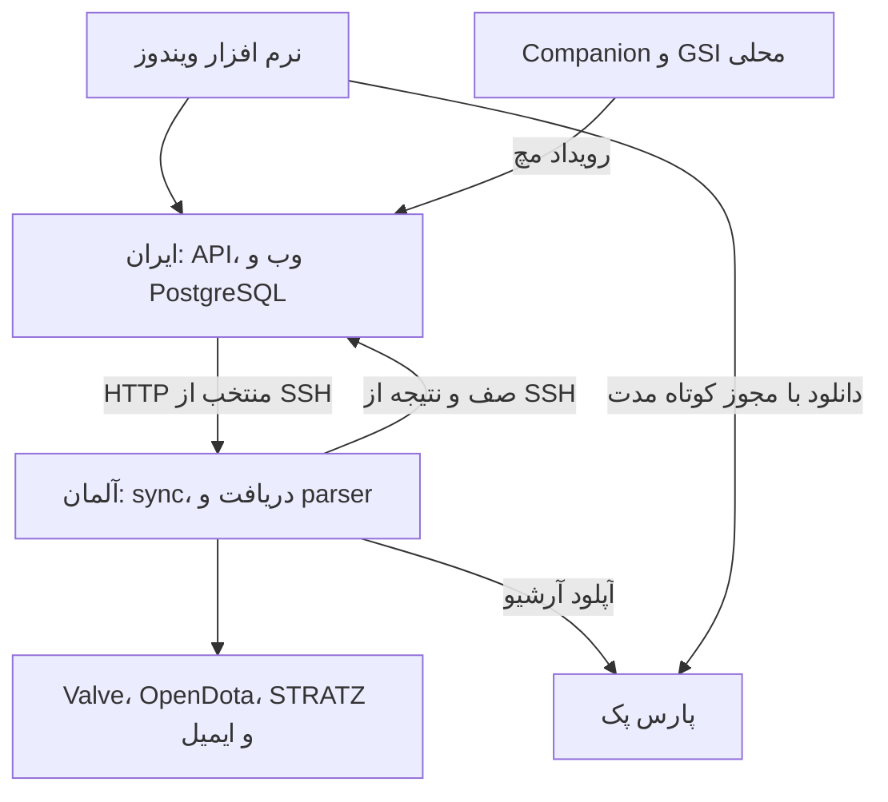

# معماری جاری: برنامه در ایران، پردازش در آلمان

## نقش ها و مالکیت داده

یک PostgreSQL اصلی در ایران وجود دارد. API عمومی session، تاریخچه، تنظیمات، تسک ها و درخواست های کاربر را از همین DB می خواند یا در آن ثبت می کند.
آلمان همان صف ها را از طریق SSH می گیرد و نتیجه را در همان دیتابیس می نویسد. کپی دوم و sync دو دیتابیس نداریم.
`DOTA_NODE_ROLE=standalone` فقط برای توسعه یا سازگاری نصب تک سرور پشتیبانی می شود.

## مسیر ارتباط خصوصی

آلمان با `dota2notes-link.service` یک اتصال SSH به حساب محدود `dota-link` ایران برقرار می کند:

| listener | مقصد | کاربرد |
| --- | --- | --- |
| آلمان `127.0.0.1:15432` | ایران `127.0.0.1:5432` | SQL با نقش محدود compute |
| ایران `127.0.0.1:14100` | آلمان `127.0.0.1:4100` | هدایت HTTP منتخب به compute |

هر دو listener فقط loopback هستند. PostgreSQL و API خصوصی آلمان نباید روی اینترنت باز شوند.
API ایران فقط مسیرهای صریح `isComputeRoute` را هدایت می کند؛ مقصد از ورودی کاربر گرفته نمی شود.
پل از `DOTA_COMPUTE_TOKEN` مشترک استفاده می کند. این secret جای session کاربر یا `SYNC_WORKER_SECRET` را نمی گیرد.
سقف فعلی پل HTTP قابل تنظیم و حداکثر ۱۸۰ ثانیه است؛ POST نوشتنی در خود پل خودکار تکرار نمی شود.
فهرست allowlist در سورس مرجع است؛ هر تغییر route باید تست topology را هم پوشش بدهد.

## مسیر داده هر قابلیت

| قابلیت | جریان |
| --- | --- |
| دریافت دستی | ایران job را ثبت می کند؛ daemon آلمان snapshot و جزئیات لازم را می گیرد و در DB ایران می نویسد |
| پایان بازی محلی | Dota به GSI روی loopback ویندوز می فرستد؛ Companion رویداد را به ایران می رساند؛ آلمان بعد از موعد بررسی می کند |
| بازی روی سیستم دیگر | دریافت دوره ای سرور یا Fetch دستی، وابستگی به دریافت رویداد همان دستگاه را جبران می کند |
| تحلیل ریپلی | دریافت و spool معتبر در آلمان؛ Java در آلمان؛ نتیجه در DB ایران |
| آرشیو | از spool آلمان به پارس پک، با صف مستقل از parse |
| دانلود کاربر | ایران وضعیت و ticket می دهد؛ native فایل را مستقیم از پارس پک می گیرد |
| assets عمومی | از ایران به کش مستقل ویندوز؛ این مسیر از آرشیو خصوصی ریپلی جداست |
| مانیتور | مسیر منتخب ادمین به compute می رود؛ snapshot سیستم عامل متعلق به آلمان است |

Companion یک Windows Service با حساب SYSTEM نیست. یک executable مستقل با Task Scheduler و نشست کاربر است؛ بدون UI کار می کند اما هنگام خاموش بودن سیستم یا خروج از نشست ویندوز، پردازش محلی ندارد.
GSI به معنی اتصال مستقیم کلاینت ما به Game Coordinator نیست. راهنمای کامل در [دریافت خودکار](automatic-match-discovery.fa.md) است.

## صف و همزمانی

DB از lease، heartbeat، قفل و وضعیت مستقل job استفاده می کند. daemon sync بعد از هر tick پنج ثانیه مکث دارد؛ زمان انجام خود tick هم به این فاصله اضافه می شود.
replay pipeline به صورت service مداوم اجرا می شود، نه replay timer پانزده ثانیه ای.
تنظیم نصب فعلی آلمان دو lane آماده سازی، دو parser و یک archive است؛ این اعداد ظرفیت اثبات شده برای همه سخت افزارها نیستند.
درخواست دانلود، اولویت محدود و منصفانه دارد؛ انتقال فعال قبلی قطع نمی شود و فایل پیش از تایید integrity قابل دانلود اعلام نمی شود.

## قطع لینک و محدودیت ها

در قطع لینک، خواندن داده ذخیره شده و enqueue محلی ایران با سالم بودن API/DB ادامه دارند.
ورود یا ایمیل و route وابسته به upstream می تواند `503 compute_unavailable` یا `compute_timeout` بدهد.
workerها متوقف یا با خطا و lease recovery ادامه پیدا می کنند؛ reconnect به معنی حذف تمام خطاهای مسیر نیست.
بعد از توقف عمدی unit لینک ممکن است لازم باشد سرویس های وابسته را صریح شروع کنیم؛ این کار جزو آپدیت عادی نیست.

دسترسی کاربران خارج فعلا به API ایران است. ورودی چند منطقه ای و failover خودکار وجود ندارد.
اندازه گیری S3، زمان SQL یا parse را اثبات نمی کند؛ [گزارش شبکه](network-baseline-2026-11.fa.md) فقط نمونه های ثبت شده را بیان می کند.
